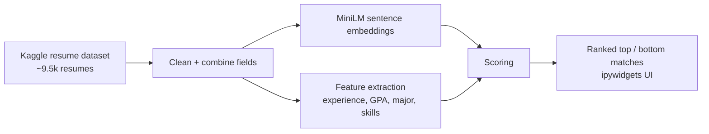

# SwiftScreen

**A resume screener that ranks applicants for a job in seconds.** Type a job description or keywords, and SwiftScreen scores ~9,500 resumes from 0 to 10 and shows the strongest and weakest matches with their major, experience, GPA and skills.

Built with a team at **UCSB DataOrbit 2025** (datathon), as a Colab notebook with an interactive widget UI.

<!-- TODO(Hratch): add a screenshot or short GIF of the widget returning results, e.g. docs/media/swiftscreen-demo.gif -->

## How it works

1. **Preprocessing.** Drops ID-like and date columns, fills gaps, and joins each resume's fields into one text block.
2. **Embeddings.** Encodes every resume with `all-MiniLM-L6-v2` (Sentence Transformers).
3. **Feature extraction.** Pulls years of experience and GPA (normalized to a 4.0 scale) from free text.
4. **Scoring.** Each resume gets a 0 to 10 score that combines:
   - fuzzy skill match between the query and the resume's skills (weighted highest, with a minimum-relevance cutoff that zeroes out weak matches)
   - an experience boost that grows faster than linearly with years
   - a bonus for relevant majors (CS, software engineering, data science, AI, IT)
   - a small GPA bonus
5. **UI.** An `ipywidgets` text box and button return the top and bottom matches inline.

## Tech Stack

Python, pandas, Sentence Transformers (MiniLM), PyTorch, scikit-learn, ipywidgets, Google Colab

## Run it

The easiest path is Google Colab:

1. Open `final_resume_screener_original_with_widget.ipynb` in Colab.
2. Upload `resume_data.csv` to your Google Drive (the notebook reads `/content/drive/MyDrive/resume_data.csv`), or change `file_path` to wherever you put it.
3. Run all cells, then type a query like `Python machine learning` into the widget.

`final_resume_screener.py` is a plain-Python export of the same notebook.

## Limitations and next steps

This was a time-boxed datathon build, and these are the honest gaps:

- **The neural scorer isn't trained yet.** `ResumeMatchModel` (a 3-layer PyTorch network over the embeddings) is defined and its output is blended into the score, but the training loop wasn't finished, so ranking is driven by the weighted rules above.
- **The query embedding isn't used.** Next step: rank by cosine similarity between the job description and resume embeddings, then fine-tune the scorer on labeled job/resume pairs (the dataset includes a `matched_score` column that could serve as labels).
- **Major filtering is keyword-based**, which favors technical roles.
- **Colab-only** because of `drive.mount`; a small Gradio or Streamlit app would make it runnable and hostable anywhere.

## Data

A public resume dataset from Kaggle (`resume_data.csv`, ~9.5k rows), included in this repo.
